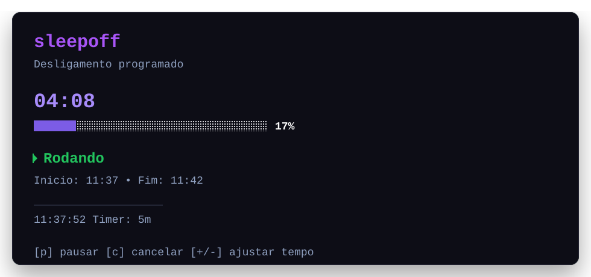

<p align="center">
  
</p>

<h1 align="center">sleepoff</h1>

<p align="center">Timer de desligamento automático moderno e resiliente para Windows, macOS e Linux</p>

<p align="center">
  <a href="#instalacao"></a>
  <a href="#instalacao"></a>
  <a href="#instalacao"></a>
  
  
</p>

<p align="center">
  Um utilitário CLI multiplataforma em Go (compilado 100% estático com <code>CGO_ENABLED=0</code>) para programar o desligamento da sua máquina. Conta com TUI interativa baseada no Charm Bubble Tea, modo direto via linha de comando, pausa/retomada, ajuste de tempo em tempo de execução e contagem regressiva de pânico de 10 segundos com alertas sonoros antes do shutdown.
</p>

<p align="center">
  🌐 <strong>Experimente agora no navegador:</strong><br>
  <a href="https://pasqualotodiogenes.github.io/sleepoff/"><strong>Acesse o Live Demo Interativo (GitHub Pages)</strong></a>
</p>

---

##  Live Demo & Preview

Teste a interface interativa completa (com sintetizador de áudio via Web Audio API e navegação por teclado) diretamente no seu navegador através do [Simulador TUI do sleepoff](https://pasqualotodiogenes.github.io/sleepoff/).



---

##  Instalação

Binários estáticos pré-compilados estão disponíveis na página de [Releases do GitHub](https://github.com/pasqualotodiogenes/sleepoff/releases/latest).

### Windows

#### 1. Instalador Automático (Inno Setup)
Baixe o instalador oficial `sleepoff-setup.exe`:
- [Download do Instalador Windows](https://github.com/pasqualotodiogenes/sleepoff/releases/latest/download/sleepoff-setup.exe)

O instalador configura o binário em `%LocalAppData%\Programs\sleepoff\`, adiciona o diretório ao `PATH` do usuário, cria atalhos no Menu Iniciar e habilita verificação semanal de updates.

#### 2. Zip Portable
Baixe `sleepoff_windows_amd64.zip`, descompacte em qualquer pasta e execute:
- [Download do ZIP Portable](https://github.com/pasqualotodiogenes/sleepoff/releases/latest/download/sleepoff_windows_amd64.zip)

```powershell
.\sleepoff.exe 45m
```

---

### Linux

Baixe o arquivo compactado correspondente à arquitetura do seu processador (`amd64` ou `arm64`) e extraia o binário estático no seu `PATH`:

```bash
# Para arquitetura x86_64 (amd64)
curl -sSL "https://github.com/pasqualotodiogenes/sleepoff/releases/latest/download/sleepoff_linux_amd64.tar.gz" | sudo tar -xz -C /usr/local/bin sleepoff

# Para arquitetura ARM64 (aarch64)
curl -sSL "https://github.com/pasqualotodiogenes/sleepoff/releases/latest/download/sleepoff_linux_arm64.tar.gz" | sudo tar -xz -C /usr/local/bin sleepoff

# Garanta permissão de execução
sudo chmod +x /usr/local/bin/sleepoff
```

> [!TIP]
> No Linux, o `sleepoff` usa `systemctl poweroff` através do `systemd-logind` / D-Bus sem exigir `sudo` em sessões de desktop. Se você encontrar problemas de permissão em sessões SSH remotas, consulte o [Guia de Solução de Problemas](docs/troubleshooting.md#2-linux-systemd-d-bus-e-permissões-sem-sudo).

---

### macOS

Baixe o arquivo compactado para Apple Silicon (`arm64`) ou processadores Intel (`amd64`):

```bash
# Para Apple Silicon (M1/M2/M3/M4 - arm64)
curl -sSL "https://github.com/pasqualotodiogenes/sleepoff/releases/latest/download/sleepoff_darwin_arm64.tar.gz" | sudo tar -xz -C /usr/local/bin sleepoff

# Para Intel (x86_64 - amd64)
curl -sSL "https://github.com/pasqualotodiogenes/sleepoff/releases/latest/download/sleepoff_darwin_amd64.tar.gz" | sudo tar -xz -C /usr/local/bin sleepoff

# Garanta permissão de execução
sudo chmod +x /usr/local/bin/sleepoff
```

> [!IMPORTANT]
> No macOS, o desligamento é executado via Apple Events (`osascript`). Ao final do primeiro timer, o macOS solicitará permissão de **Automação** para o seu terminal. Consulte o [Guia de Solução de Problemas](docs/troubleshooting.md#1-macos-permissões-de-automação-e-apple-events) para detalhes de configuração no TCC.

---

### Instalação via Go

Se você possui a toolchain Go (versão `1.25+`) instalada:

```bash
go install github.com/pasqualotodiogenes/sleepoff@latest
```

---

##  Como Usar

### Exemplos de Uso

```bash
# Abre o menu interativo com seleção visual de tempo
sleepoff

# Inicia timer direto de 30 minutos sem abrir o menu
sleepoff 30m

# Inicia timer de 1 hora em modo seguro de teste (não desliga o sistema)
sleepoff 1h --dry-run

# Exibe comandos, opções e ajuda
sleepoff --help
```

### Formatos de Duração Aceitos

O `sleepoff` faz parsing flexível de argumentos de tempo:

| Formato | Interpretação | Exemplo de Comando |
| :--- | :--- | :--- |
| `30` | Inteiro sem unidade (interpretado como minutos) | `sleepoff 30` |
| `30m` | Minutos com sufixo `m` | `sleepoff 30m` |
| `90s` | Segundos com sufixo `s` | `sleepoff 90s` |
| `1h` | Horas com sufixo `h` | `sleepoff 1h` |
| `1h30m` | Horas e minutos combinados | `sleepoff 1h30m` |

---

##  Flags e Parâmetros da CLI

Tabela exata das flags suportadas pelo executável:

| Flag | Flag Curta | Descrição Técnica |
| :--- | :---: | :--- |
| `--dry-run` | *(nenhuma)* | Ativa o **Modo de Teste**. Executa o fluxo visual completo da TUI, logs, alertas sonoros e a contagem regressiva de pânico de 10 segundos, mas **não** efetua o desligamento real do computador. |
| `--help` | `-h` | Exibe a tela de ajuda personalizada com banner ASCII, documentação de comandos, flags e controles. |
| `--version` | `-v` | Exibe a versão do binário, hash do commit e informações de build. |

---

##  Tabela de Controles e Atalhos

Todos os atalhos de teclado implementados no ciclo de atualização da TUI:

| Tecla / Atalho | Estado Válido | Ação Realizada |
| :--- | :--- | :--- |
| `p` ou `Espaço` | Durante o Timer (`StateRunning`) | **Pausar / Retomar**: Congela o tempo restante e ajusta a hora prevista de finalização. |
| `+` ou `=` | Durante o Timer (`StateRunning`) | **Adicionar 5 minutos**: Soma 5 minutos ao tempo restante e à duração total programada. |
| `-` ou `_` | Durante o Timer (`StateRunning`) | **Remover 5 minutos**: Subtrai 5 minutos (garantindo um piso de no mínimo 1 minuto restante). |
| `c`, `q` ou `Esc` (2x) | Durante o Timer (`StateRunning`) | **Cancelar (Confirmação Dupla)**: Requer duas ativações em um intervalo de 2 segundos para evitar cancelamentos acidentais. |
| `c` ou `Esc` (1x) | Tela de Pânico (`StateConfirmation`) | **Abortar Desligamento**: Cancela o shutdown imediatamente durante a contagem regressiva de 10 segundos. |
| `↑` / `↓` ou `k` / `j` | Menu Principal (`StateMenu`) | **Navegar**: Seleciona tempos predefinidos (15m, 30m, 45m, 1h, 1h30m, 2h ou Personalizado). |
| `Enter` | Menu / Input Customizado | **Confirmar**: Inicia o timer com a opção selecionada ou confirma o tempo em minutos digitado. |
| `Esc` | Input Customizado (`StateCustomInput`) | **Voltar**: Retorna à lista do menu principal sem iniciar o timer. |
| `q` | Menu Principal (`StateMenu`) | **Sair**: Encerra a aplicação sem agendar desligamento. |
| `Ctrl+C` | Qualquer estado | **Interrupção de Emergência**: Aborta o processo imediatamente via sinal de terminal. |

---

##  Compilação e Arquitetura

O `sleepoff` foi projetado para portabilidade estrita, dispensando runtime C e links dinâmicos:

- **Linguagem:** Go `1.25+`
- **Compilação Estática:** `CGO_ENABLED=0` em todos os targets
- **Arquiteturas Suportadas:** `windows/amd64`, `windows/arm64`, `linux/amd64`, `linux/arm64`, `darwin/amd64`, `darwin/arm64`

```bash
# Clonar repositório
git clone https://github.com/pasqualotodiogenes/sleepoff.git
cd sleepoff

# Validar testes e vetores
go test ./...
go vet ./...

# Compilar para a sua plataforma atual
CGO_ENABLED=0 go build -o sleepoff .
```

Para uma análise aprofundada dos mecanismos internos de sistema operacional (POSIX flock vs Win32 Mutex, D-Bus systemd-logind, Apple Events e subsistemas de áudio), leia [ARCHITECTURE.md](ARCHITECTURE.md).

Em caso de problemas com permissões de desligamento ou automação de terminal, consulte o [Guia de Solução de Problemas](docs/troubleshooting.md).

---

##  Licença

Distribuído sob a licença MIT. Consulte [LICENSE](LICENSE) para mais detalhes.
